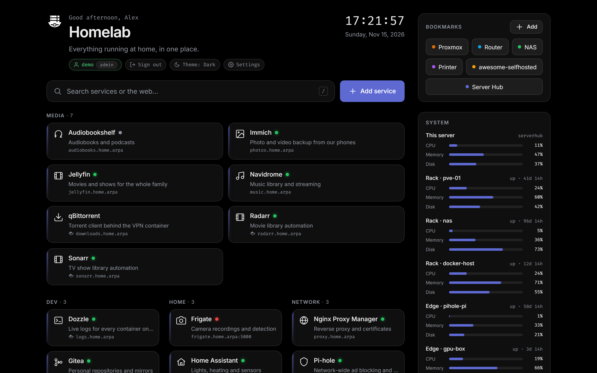
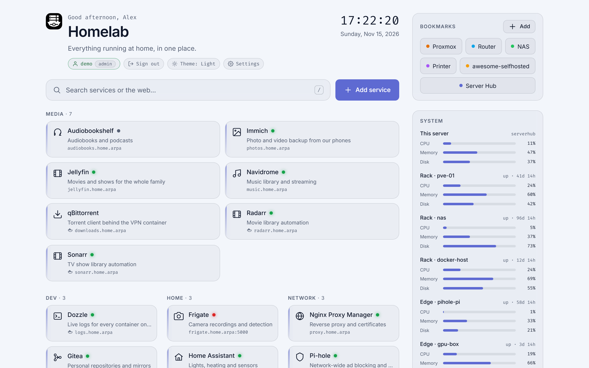
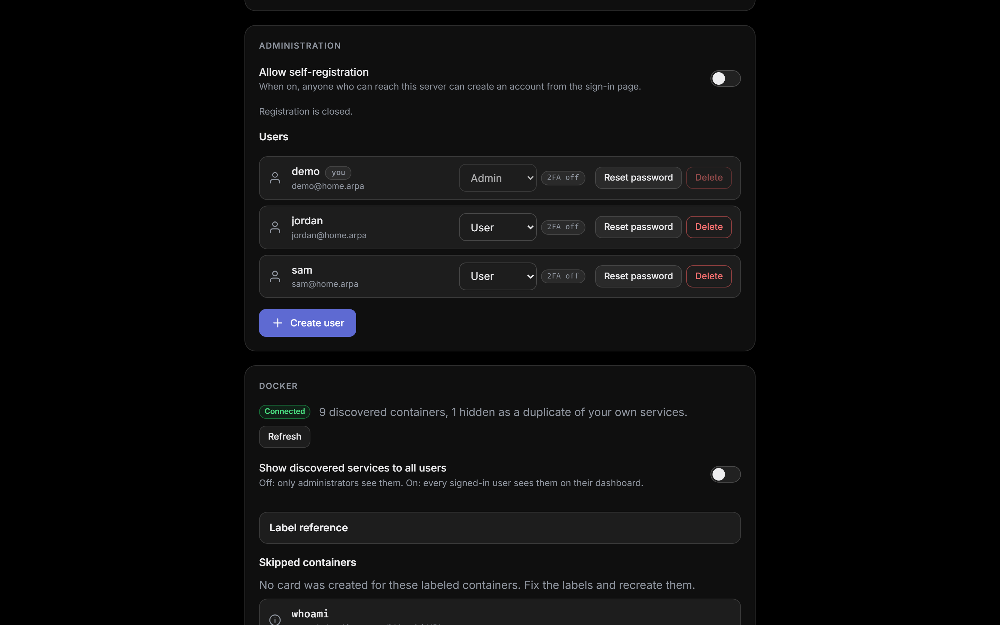
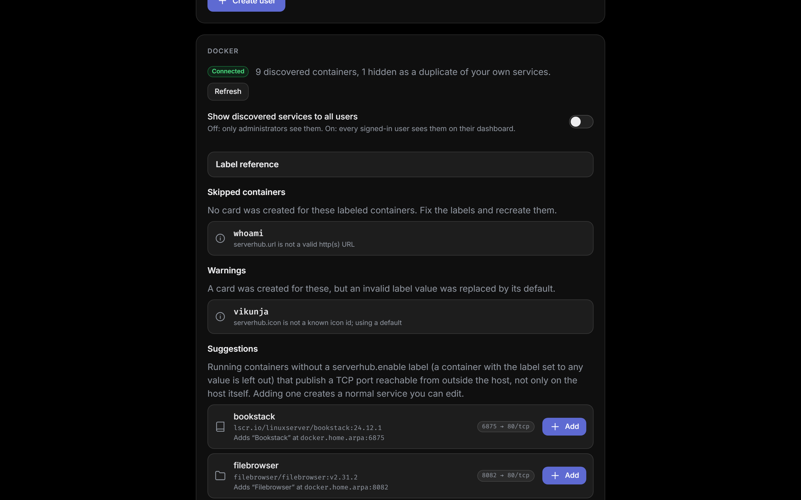
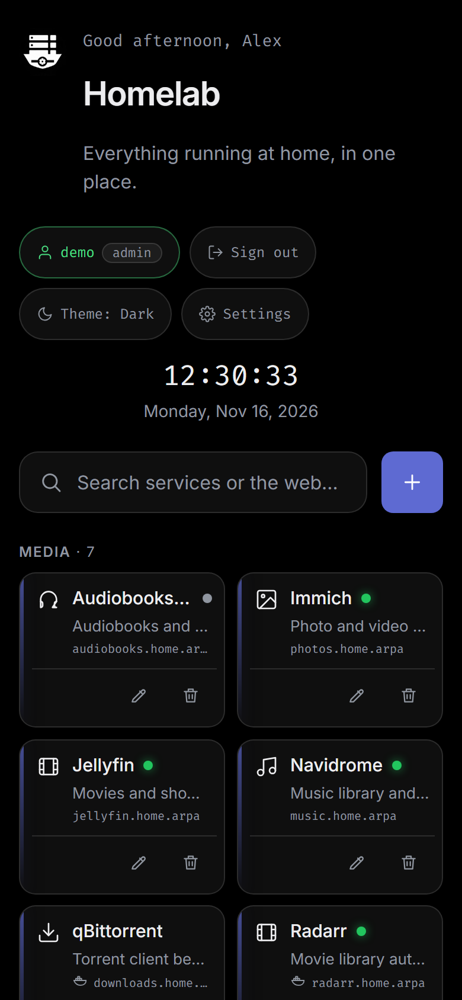

<div align="center">


# Server Hub

**A self-hosted dashboard for your apps and services.**

[](https://github.com/eco-null/server-hub/actions/workflows/ci.yml)
[](LICENSE)
[](pyproject.toml)
[](compose.yaml)
[](https://eco-null.github.io/server-hub/)

### [Try the live demo](https://eco-null.github.io/server-hub/)

The real interface running entirely in your browser, with sample data. Nothing is sent to a server.



[Demo](#live-demo) · [Quick start](#quick-start-docker-compose) · [Configuration](#configuration) · [HTTPS](#https) · [Backup](#backup-and-restore) · [Docs](#documentation)

</div>

## What it is

Server Hub is one page that lists the web apps and services you run, shows whether each one is up, and optionally shows CPU, memory and disk figures from the host and from your [Beszel](https://beszel.dev) hubs. It runs as a single container with a SQLite database. There is no external database, identity provider or reverse proxy: accounts, sessions and two-factor authentication are built in, and the app can serve HTTPS itself.

Version 2 is a rewrite. It does not read data from the previous Supabase/Vercel version; see [CHANGELOG.md](CHANGELOG.md).

## Features

**Dashboard**
- Service tiles with name, address, description, icon and category, grouped by category; bookmarks in a side panel.
- Categories are detected from the name, host and description, or set by hand.
- Search field (press `/`) that matches your services first and falls back to a web search with a configurable provider: Google, DuckDuckGo, Bing, Startpage or your own SearXNG.
- Optional clock and greeting. Changes made in another tab of the same browser appear on the dashboard without a reload.

**Monitoring**
- Server-side status checks (`up`, `down`, `unknown`) with a short cache and a hard time limit; admins also see the HTTP status and latency.
- Host CPU, memory and disk figures for admins, read from `/proc` (Linux only).
- Beszel integration: list the systems of one or more Beszel hubs on the dashboard.
- Docker discovery (optional, off by default): containers you label become service cards, and admins get one-click suggestions for other containers that publish a port. Server Hub never mounts the Docker socket; it reads the container list through a proxy that allows nothing else. See [Docker discovery](#docker-discovery).

**Personalization**
- Dark (default, plain black), light or automatic theme, accent color, wallpaper (gradient presets or an image URL), optional grid overlay.
- Page title, subtitle and your name for the greeting; each dashboard feature can be switched off.
- Settings, services and bookmarks are stored per user. Export and import them as a JSON file (no secrets included).

**Accounts and security**
- First-run setup protected by a setup token; the first account is the admin. Registration is closed by default and an admin can open it.
- Roles `admin` and `user`; admins manage users in the settings page.
- Argon2id password hashing, server-side sessions, optional TOTP two-factor authentication with recovery codes.
- Strict Content Security Policy, CSRF checks, Host allowlist, persistent rate limiting and outbound request filtering. Details in [SECURITY.md](SECURITY.md).

**Operations**
- One container with a read-only root filesystem, all capabilities dropped and a non-root user.
- Built-in TLS with your own certificate and key.
- `/healthz` endpoint and a Docker health check.
- CLI for creating admins, resetting passwords and taking consistent database backups.

## Live demo

**https://eco-null.github.io/server-hub/** is a static build of the real web interface from `web/`. The HTTP API is answered by a mock backend inside your browser, and everything you change is kept in that browser's `localStorage`. The demo's sign-in credentials are shown on its login page.

What is simulated, and how the demo differs from a real install:

- There is no server. Status checks, Beszel hubs and host statistics are generated in the browser. The sample services point at `*.home.arpa` names that do not resolve.
- Docker discovery runs against a made-up Docker host with a fixed list of containers, so you can see cards, skipped containers, warnings and suggestions, and try the "Show discovered services to all users" switch. No Docker API or socket proxy is involved.
- A Beszel hub you add always connects and reports one or two made-up systems.
- Changing your own password is checked but not applied, so the demo credentials keep working. Resetting the demo account's password is ignored for the same reason.
- There is no rate limiting, only one demo session per browser, and the first-run setup is never shown.
- Wallpaper images from other sites are blocked by the demo's Content Security Policy.
- Two-factor authentication works with a real authenticator app. Use the "Reset demo" button in the demo banner if you lose the codes.

The demo shows how the interface looks and behaves; it does not exercise the real server, so it says nothing about how an installation is secured or deployed. To build and preview it locally, see [docs/DEVELOPMENT.md](docs/DEVELOPMENT.md#the-demo-github-pages).

## Screenshots

The screenshots show the demo data.

<details>
<summary>Show all screenshots</summary>

<table>
  <tr>
    <td align="center"><br><sub>Dashboard, light theme</sub></td>
    <td align="center"><br><sub>Search: matching services, then a web search</sub></td>
  </tr>
  <tr>
    <td align="center"><br><sub>Edit a service</sub></td>
    <td align="center"><br><sub>Settings: appearance</sub></td>
  </tr>
  <tr>
    <td align="center"><br><sub>Settings: administration</sub></td>
    <td align="center"><br><sub>Sign-in page</sub></td>
  </tr>
  <tr>
    <td align="center"><br><sub>Settings: Docker discovery</sub></td>
    <td align="center"><br><sub>Dashboard on a phone</sub></td>
  </tr>
</table>

</details>

## Quick start (Docker Compose)

You need a Linux host with Docker, the Compose plugin and Git.

```bash
git clone https://github.com/eco-null/server-hub.git
cd server-hub
cp .env.example .env
sed -i "s|^SERVERHUB_SECRET_KEY=.*|SERVERHUB_SECRET_KEY=$(openssl rand -hex 24)|" .env
docker compose up -d --build
```

The `sed` line writes a random 48-character secret key into `.env`. Keep a copy of it with your backups; see [Backup and restore](#backup-and-restore) and [docs/DEPLOYMENT.md](docs/DEPLOYMENT.md#secret-key).

On the first start, with no account in the database, the server prints a setup token in its log:

```bash
docker compose logs server-hub | grep "SETUP TOKEN"
```

Open `http://<server-address>:8642` in a browser (use the machine's IP address, or `localhost` on the same machine), enter the token and create the admin account. The token changes on every start until the first account exists. To choose it yourself, set `SERVERHUB_SETUP_TOKEN` (16 or more characters) in `.env` before starting.

Without TLS the server speaks plain HTTP and logs a warning. That is acceptable on a trusted LAN or VPN; otherwise enable [HTTPS](#https).

## Configuration

Settings are environment variables, read at startup. With Docker Compose, put them in `.env`; the file [`.env.example`](.env.example) documents every one. A bad value stops the server with a message that names the variable. Names are case-insensitive and unknown `SERVERHUB_*` names are ignored, so check the spelling. Booleans accept `true`/`false` (also `1`/`0`, `yes`/`no`, `on`/`off`).

| Variable | Default | Purpose |
|---|---|---|
| `SERVERHUB_SECRET_KEY` | none, **required** | At least 32 characters. Encrypts 2FA secrets and stored Beszel passwords and keys the recovery-code hashes. Passwords and sessions do not depend on it. |
| `SERVERHUB_PUBLISH_PORT` | `8642` | Host port published by `compose.yaml`. Read by Compose only; the container always listens on 8642. |
| `SERVERHUB_DATA_DIR` | `./data` | Directory that holds the SQLite database `serverhub.db`. Under Compose, `compose.yaml` fixes it to `/data`. |
| `SERVERHUB_HOST` | `0.0.0.0` | Address to listen on. Fixed to `0.0.0.0` by `compose.yaml`. |
| `SERVERHUB_PORT` | `8642` | Port to listen on (1-65535). Fixed to `8642` by `compose.yaml`; change `SERVERHUB_PUBLISH_PORT` instead. |
| `SERVERHUB_PUBLIC_URL` | unset | The URL users type in the browser, for example `https://hub.example.org:8642`. Its host is allowed in the `Host` header, it is accepted as `Origin` for the CSRF check, and an `https` URL turns on Secure cookies. |
| `SERVERHUB_TLS_CERT_FILE` | unset | PEM certificate with its full chain. Set it together with the key file; the file must exist. |
| `SERVERHUB_TLS_KEY_FILE` | unset | PEM private key. |
| `SERVERHUB_COOKIE_SECURE` | `auto` | `auto`, `true` or `false`. `auto` uses Secure cookies when TLS is on or `SERVERHUB_PUBLIC_URL` is `https`. |
| `SERVERHUB_TRUSTED_PROXIES` | empty | Comma-separated CIDRs of proxies or tunnel endpoints whose `X-Forwarded-For` and `X-Forwarded-Proto` headers are trusted. Empty means the client address is the TCP peer. |
| `SERVERHUB_ALLOWED_HOSTS` | empty | Comma-separated host names (names only, no scheme or port) accepted in the `Host` header, in addition to IP addresses, `localhost` and the host of `SERVERHUB_PUBLIC_URL`. |
| `SERVERHUB_SETUP_TOKEN` | random per start | Token required to create the first account. 16 or more characters. Ignored once an account exists. |
| `SERVERHUB_MAX_CONNECTIONS` | `512` | Maximum open connections (16-100000). |
| `SERVERHUB_MAX_CONNECTIONS_PER_IP` | `32` | Maximum open connections per client address, IPv6 per /64 (2-10000). Loopback and trusted proxies are exempt. |
| `SERVERHUB_ALLOW_PRIVATE_NETWORK_TARGETS` | `true` | Allow status checks and Beszel to reach private ranges (10/8, 172.16/12, 192.168/16, 100.64/10, fc00::/7). Loopback, link-local, cloud-metadata, multicast and reserved ranges are always blocked. |
| `SERVERHUB_SESSION_IDLE_DAYS` | `7` | A session expires after this many idle days. Greater than 0, at most 365, may be fractional. |
| `SERVERHUB_SESSION_MAX_DAYS` | `30` | A session expires after this many days regardless of activity. At least the idle value, at most 365. |
| `SERVERHUB_LOG_LEVEL` | `info` | `critical`, `error`, `warning`, `info` or `debug`. `warning` is the quietest level that still prints the setup token and the configuration warnings; `error` and `critical` hide them. `debug` adds an access log line per request and is for troubleshooting only. |
| `SERVERHUB_DOCKER_HOST` | unset (discovery off) | Address of the Docker socket proxy, `tcp://host:port` or `http://host:port`; `tcp://docker-proxy:2375` with the shipped `compose.yaml`. `unix://` sockets are refused. See [Docker discovery](#docker-discovery). |
| `SERVERHUB_DOCKER_PUBLIC_HOST` | unset | Host name or IP address your browser uses for the Docker host, such as `nas.lan` (no scheme, port or path). Used to build the suggested URL of a published port; without it, suggestions have no URL. |
| `COMPOSE_PROFILES` | unset | Read by Docker Compose, not by Server Hub. Set it to `docker` to start the socket proxy. |
| `DOCKER_GID` | unset | Read by Docker Compose, not by Server Hub. The numeric group that owns the Docker socket on the host; the proxy runs with it. |
| `SERVERHUB_WEB_DIR` | `web/` next to the `serverhub/` package | Directory with the frontend files. For development only; leave it unset in Docker. |

## HTTPS

There is no reverse proxy: the app terminates TLS itself. Put a PEM certificate (full chain) and its private key in a `certs` directory next to `compose.yaml`. Create the directory first, otherwise Docker creates an empty root-owned one:

```bash
mkdir -p certs
cp -L /path/to/fullchain.pem /path/to/privkey.pem certs/
sudo chown 10001:10001 certs/privkey.pem
chmod 600 certs/privkey.pem
chmod 644 certs/fullchain.pem
chmod 755 certs
```

Do not edit `compose.yaml`. Create `compose.override.yaml` next to it. Compose merges that file automatically and Git ignores it, so `git pull` never conflicts:

```yaml
services:
  server-hub:
    volumes:
      - ./certs:/certs:ro
    environment:
      SERVERHUB_TLS_CERT_FILE: /certs/fullchain.pem
      SERVERHUB_TLS_KEY_FILE: /certs/privkey.pem
```

Add the address people will type to `.env`:

```bash
SERVERHUB_PUBLIC_URL=https://hub.example.org:8642
```

Then restart:

```bash
docker compose up -d
```

The server reads the certificate at startup only, so restart it after a renewal (`docker compose restart server-hub`). A self-signed certificate works too; see [docs/DEPLOYMENT.md](docs/DEPLOYMENT.md#tls-with-a-self-signed-certificate).

**The startup warning.** If the server listens on a non-loopback address without TLS and without an `https` `SERVERHUB_PUBLIC_URL`, it logs `Serving PLAIN HTTP ...`: passwords and session cookies cross the network unencrypted. A second warning says that Secure cookies are on while the process serves plain HTTP. Browsers drop Secure cookies on `http://` pages, so signing in over plain HTTP loops back to the login page. Open the hub through its `https://` URL, enable TLS, or set `SERVERHUB_COOKIE_SECURE=false`.

**Behind a tunnel or an external proxy.** If something else terminates TLS in front of Server Hub:

- set `SERVERHUB_PUBLIC_URL` to the public `https://` URL;
- set `SERVERHUB_TRUSTED_PROXIES` to the address (CIDR) the proxy connects from, so the client address and the `https` scheme are taken from `X-Forwarded-For` and `X-Forwarded-Proto`. Without it, every visitor looks like the proxy and shares one rate-limit and connection budget;
- add any other host name the proxy forwards to `SERVERHUB_ALLOWED_HOSTS`.

More in [docs/DEPLOYMENT.md](docs/DEPLOYMENT.md#running-behind-a-tunnel-or-proxy).

## Accessing by hostname

Every request is checked against a Host allowlist (protection against DNS rebinding). IP addresses and `localhost` are always accepted. Any other name, such as `hub.lan`, must be listed in `SERVERHUB_ALLOWED_HOSTS` or be the host of `SERVERHUB_PUBLIC_URL`. Otherwise the server answers `400` with this text:

```
Host 'hub.lan' is not allowed. Add it to SERVERHUB_ALLOWED_HOSTS (comma-separated host names) or set SERVERHUB_PUBLIC_URL, then restart Server Hub.
```

Fix it and restart:

```bash
echo "SERVERHUB_ALLOWED_HOSTS=hub.lan" >> .env
```

```bash
docker compose up -d
```

## Docker discovery

Optional, off by default. Server Hub can show the containers on your Docker host as service cards. It never mounts the Docker socket: a separate `docker-proxy` container, which allows exactly one request (the container list), has the socket instead. Turn it on in `.env`, with the group that owns the socket (`stat -c %g /var/run/docker.sock`):

```bash
COMPOSE_PROFILES=docker
SERVERHUB_DOCKER_HOST=tcp://docker-proxy:2375
DOCKER_GID=998
```

```bash
docker compose up -d
```

Then label a container. Both `serverhub.enable` and `serverhub.url` are required:

```yaml
services:
  grafana:
    image: grafana/grafana
    labels:
      serverhub.enable: "true"
      serverhub.url: "http://nas.lan:3000"
```

Admins see the result, skipped containers and suggestions in Settings, Docker. Other users see discovered services only if an admin switches that on. Labels are trusted input from whoever can start containers on the host, because they choose the address the card opens and the server requests for status checks. All labels, the access model, status checks, the security considerations and troubleshooting are in [docs/DEPLOYMENT.md](docs/DEPLOYMENT.md#docker-discovery).

## Backup and restore

All data lives in one SQLite file in the data volume. Take a consistent copy while the server is running. The first command writes inside the volume (the only writable place), the second copies the file to the host (create `./backups` first), the third removes the copy in the volume:

```bash
docker compose exec server-hub python -m serverhub backup /data/backup-$(date +%F).db
docker compose cp server-hub:/data/backup-$(date +%F).db ./backups/
docker compose exec server-hub rm /data/backup-$(date +%F).db
```

Keep the backup together with the value of `SERVERHUB_SECRET_KEY`: without the key, accounts that use 2FA and stored Beszel passwords cannot be read after a restore. Restore steps and a cron example are in [docs/DEPLOYMENT.md](docs/DEPLOYMENT.md#restoring-a-backup). Users can also export their own settings, services and bookmarks as JSON from the settings page.

## Upgrade

```bash
git pull
docker compose up -d --build
```

Database migrations run automatically at start. A database written by a newer version is refused by an older build, so take a backup first if you may need to roll back ([docs/DEPLOYMENT.md](docs/DEPLOYMENT.md#upgrades-and-rollback)). Read [CHANGELOG.md](CHANGELOG.md) before upgrading.

## Password and 2FA recovery

There is no e-mail reset. Recovery is done on the server with the CLI. This sets a new password, turns 2FA off and signs the account out everywhere:

```bash
docker compose exec server-hub python -m serverhub reset-password --user NAME --disable-2fa
```

The command asks for the new password twice (10 to 128 characters). Add `--password-stdin` to read it from standard input instead. Without `--disable-2fa` the account keeps its 2FA. An admin can also clear another user's 2FA in the settings page.

To create an admin from the command line, without the setup token:

```bash
docker compose exec server-hub python -m serverhub create-admin --email you@example.org --username you
```

## Security

Passwords use Argon2id, sessions are opaque server-side tokens in `HttpOnly` cookies, 2FA secrets are encrypted at rest, and every state-changing request passes a CSRF check. Pages are served with a strict Content Security Policy, login and 2FA attempts are rate limited in the database, and the outbound requests used for status checks go through a client that refuses loopback, link-local and cloud-metadata addresses. Docker discovery reads containers through a proxy with a one-request allow-list instead of the Docker socket. [SECURITY.md](SECURITY.md) describes the model, the known limitations and how to report a vulnerability.

## Run without Docker

You need Python 3.12 or newer.

```bash
python -m venv .venv
. .venv/bin/activate
pip install --require-hashes --no-deps -r requirements.lock
export SERVERHUB_SECRET_KEY="$(python -c 'import secrets; print(secrets.token_urlsafe(48))')"
export SERVERHUB_HOST=127.0.0.1
python -m serverhub
```

The data goes to `./data`. [docs/DEVELOPMENT.md](docs/DEVELOPMENT.md) covers tests, linting and the code layout.

## Tech stack

- Backend: Python, [Starlette](https://www.starlette.io), [uvicorn](https://www.uvicorn.org) (h11), SQLite in WAL mode, pydantic, httpx.
- Security libraries: argon2-cffi, cryptography (Fernet, HKDF), pyotp, segno (QR codes).
- Frontend: plain HTML, CSS and JavaScript ES modules with no build step and no runtime dependencies; the Inter and Fira Code fonts (SIL Open Font License) are bundled.
- Packaging: Docker (Python 3.14 base image) and Docker Compose. CI runs the backend tests on Python 3.12 and 3.14.

## Documentation

- [docs/DEPLOYMENT.md](docs/DEPLOYMENT.md): operator guide
- [docs/DEVELOPMENT.md](docs/DEVELOPMENT.md): contributor guide, code layout, demo build
- [docs/API.md](docs/API.md): HTTP API reference
- [demo/README.md](demo/README.md): how the live demo works
- [CONTRIBUTING.md](CONTRIBUTING.md): how to report issues and send changes
- [SECURITY.md](SECURITY.md): security model and vulnerability reporting
- [CHANGELOG.md](CHANGELOG.md): release notes

## License

MIT. See [LICENSE](LICENSE).
