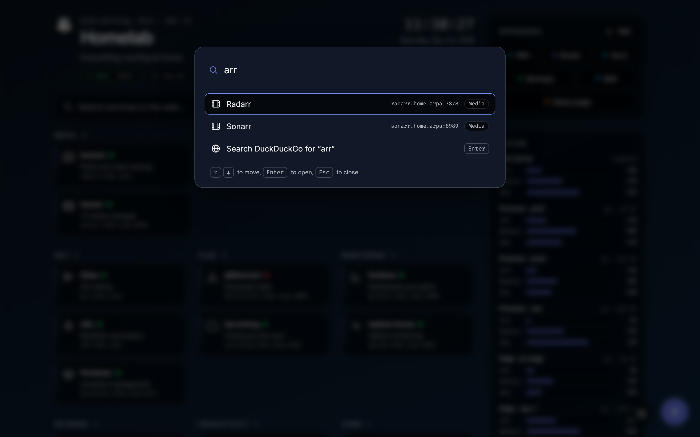
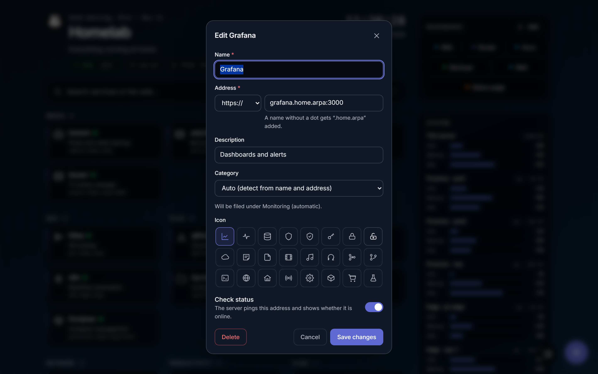
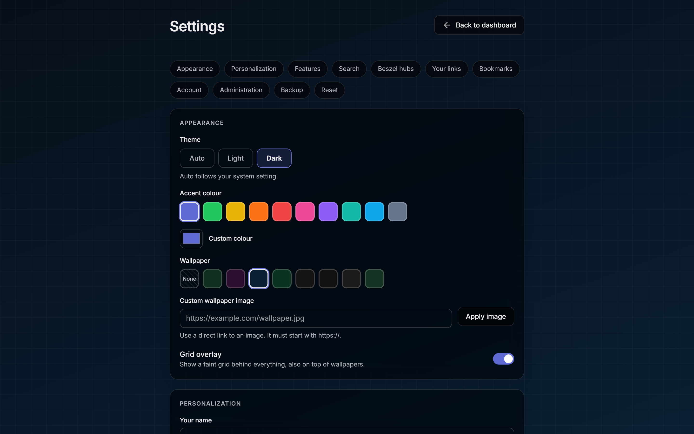
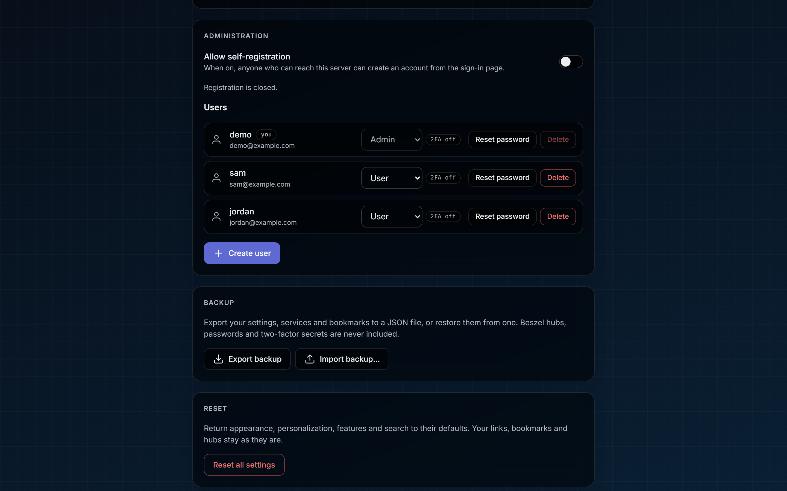
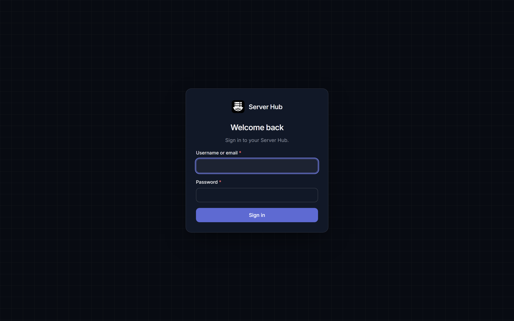

<div align="center">


# Server Hub

**A self-hosted dashboard for your apps and services.**

[](https://github.com/eco-null/server-hub/actions/workflows/ci.yml)
[](LICENSE)
[](pyproject.toml)
[](compose.yaml)


</div>

## What it is

Server Hub is one page that lists every web app and service you run, shows whether each one is up, and (optionally) shows CPU, memory and disk figures from the host and from your [Beszel](https://beszel.dev) hubs. It runs as a single container with a SQLite database. There is no external database, no identity provider and no reverse proxy in the stack: accounts, sessions and two-factor authentication are built in, and the app can serve HTTPS itself.

Version 2 is a rewrite. It does not read data from the previous Supabase/Vercel version; see [CHANGELOG.md](CHANGELOG.md).

## Features

**Dashboard**
- Service tiles with name, address, description, icon and category; bookmarks as a separate row of links.
- Categories are detected automatically from the name, host and description, or set by hand.
- Search box with a configurable provider (Google, DuckDuckGo, Bing, Startpage or your own SearXNG); press `/` to open it.
- Optional clock and greeting.

**Monitoring**
- Server-side status checks (`up`, `down`, `unknown`) with a short cache and a hard time limit; admins also see HTTP status and latency.
- Host CPU, memory and disk figures for admins (read from `/proc`, so they are only available on Linux).
- Beszel integration: list the systems of one or more Beszel hubs on the dashboard.

**Personalization**
- Dark, light or automatic theme, accent color, wallpaper (gradient presets or an image URL).
- Page title, subtitle and your name for the greeting; every dashboard feature can be switched off.
- Settings, services and bookmarks are stored per user; export and import them as a JSON file (no secrets included).

**Accounts and security**
- First-run setup protected by a setup token; the first account is the admin. Registration is closed by default and can be opened by an admin.
- Roles `admin` and `user`; admins manage users from the settings page.
- Argon2id password hashing, server-side sessions, optional TOTP two-factor authentication with recovery codes.
- Strict Content Security Policy, CSRF checks, Host allowlist, persistent rate limiting, outbound request filtering. Details in [SECURITY.md](SECURITY.md).

**Operations**
- One container, read-only root filesystem, all capabilities dropped, non-root user.
- Built-in TLS with your own certificate and key.
- `/healthz` endpoint and a Docker health check.
- CLI for creating admins, resetting passwords and taking consistent database backups.

## Screenshots

<details>
<summary>Show all screenshots</summary>

<table>
  <tr>
    <td align="center"><br><sub>Light theme</sub></td>
    <td align="center"><br><sub>Search</sub></td>
  </tr>
  <tr>
    <td align="center"><br><sub>Edit a service</sub></td>
    <td align="center"><br><sub>Settings</sub></td>
  </tr>
  <tr>
    <td align="center"><br><sub>Security settings</sub></td>
    <td align="center"><br><sub>Sign in</sub></td>
  </tr>
  <tr>
    <td align="center" colspan="2"><br><sub>Mobile</sub></td>
  </tr>
</table>

</details>

## Quick start (Docker Compose)

You need Docker with the Compose plugin and Git.

```bash
git clone https://github.com/eco-null/server-hub.git
cd server-hub
cp .env.example .env
sed -i "s|^SERVERHUB_SECRET_KEY=.*|SERVERHUB_SECRET_KEY=$(openssl rand -hex 24)|" .env
docker compose up -d --build
```

The `sed` line writes a random 48-character secret key into `.env`. Keep a copy of it with your backups; see [Backup and restore](#backup-and-restore) and [docs/DEPLOYMENT.md](docs/DEPLOYMENT.md#secret-key).

On the first start, with no account in the database, the server prints a setup token in its log:

```bash
docker compose logs server-hub | grep "SETUP TOKEN"
```

Open `http://<server-address>:8642` in a browser (use the machine's IP address, or `localhost` on the same machine), enter the token, and create the admin account. The token changes on every start until the first account exists. To choose it yourself, set `SERVERHUB_SETUP_TOKEN` (16 or more characters) in `.env` before starting.

Without TLS the server speaks plain HTTP and logs a warning. That is acceptable on a trusted LAN or VPN; otherwise enable HTTPS (below).

## Configuration

Settings are environment variables, read at startup. With Docker Compose, put them in `.env`. A bad value stops the server with a message that names the variable. Names are case-insensitive.

| Variable | Default | Purpose |
|---|---|---|
| `SERVERHUB_SECRET_KEY` | none, **required** | At least 32 characters. Encrypts 2FA secrets and stored Beszel passwords and keys the recovery-code hashes. Passwords and sessions do not depend on it. |
| `SERVERHUB_PUBLISH_PORT` | `8642` | Host port published by `compose.yaml` (read by Compose only; the container always listens on 8642). |
| `SERVERHUB_DATA_DIR` | `./data` (`/data` in the container) | Directory that holds the SQLite database `serverhub.db`. |
| `SERVERHUB_HOST` | `0.0.0.0` | Address to listen on. |
| `SERVERHUB_PORT` | `8642` | Port to listen on (1-65535). |
| `SERVERHUB_PUBLIC_URL` | unset | The URL users type in the browser, for example `https://hub.example.org:8642`. Its host is allowed in the `Host` header, it is accepted as `Origin` for the CSRF check, and an `https` URL turns on Secure cookies. |
| `SERVERHUB_TLS_CERT_FILE` | unset | PEM certificate (full chain). Must be set together with the key file; the file must exist. |
| `SERVERHUB_TLS_KEY_FILE` | unset | PEM private key. |
| `SERVERHUB_COOKIE_SECURE` | `auto` | `auto`, `true` or `false`. `auto` uses Secure cookies when TLS is on or `SERVERHUB_PUBLIC_URL` is `https`. |
| `SERVERHUB_TRUSTED_PROXIES` | empty | Comma-separated CIDRs of proxies or tunnel endpoints whose `X-Forwarded-For` and `X-Forwarded-Proto` headers are trusted. Empty means the client address is the TCP peer. |
| `SERVERHUB_ALLOWED_HOSTS` | empty | Comma-separated host names (names only, no scheme or port) accepted in the `Host` header, in addition to IP addresses, `localhost` and the host of `SERVERHUB_PUBLIC_URL`. |
| `SERVERHUB_SETUP_TOKEN` | random per start | Token required to create the first account. 16 or more characters. Ignored once an account exists. |
| `SERVERHUB_MAX_CONNECTIONS` | `512` | Maximum open connections (16-100000). |
| `SERVERHUB_MAX_CONNECTIONS_PER_IP` | `32` | Maximum open connections per client address, IPv6 per /64 (2-10000). Loopback and trusted proxies are exempt. |
| `SERVERHUB_ALLOW_PRIVATE_NETWORK_TARGETS` | `true` | Allow status checks and Beszel to reach private ranges (10/8, 172.16/12, 192.168/16, 100.64/10, fc00::/7). Loopback, link-local, cloud-metadata, multicast and reserved ranges are always blocked. |
| `SERVERHUB_SESSION_IDLE_DAYS` | `7` | A session expires after this many idle days (greater than 0, at most 365). |
| `SERVERHUB_SESSION_MAX_DAYS` | `30` | A session expires after this many days regardless of activity. Must be at least the idle value, at most 365. |
| `SERVERHUB_LOG_LEVEL` | `info` | `critical`, `error`, `warning`, `info` or `debug` (`debug` also enables access logs). Keep at least `warning` so the setup token and configuration warnings are printed. |
| `SERVERHUB_WEB_DIR` | `<project>/web` | Directory with the frontend files. Only useful for development; leave it alone in Docker. |

## HTTPS

There is no reverse proxy: the app terminates TLS itself. Mount a PEM certificate (full chain) and private key into the container and set both paths:

```bash
mkdir -p certs
cp /path/to/fullchain.pem certs/fullchain.pem
cp /path/to/privkey.pem certs/privkey.pem
sudo chown 10001:10001 certs/privkey.pem
chmod 600 certs/privkey.pem
```

Then uncomment the `./certs:/certs:ro` volume in `compose.yaml` and add to `.env`:

```bash
SERVERHUB_TLS_CERT_FILE=/certs/fullchain.pem
SERVERHUB_TLS_KEY_FILE=/certs/privkey.pem
SERVERHUB_PUBLIC_URL=https://hub.example.org:8642
```

Restart (`docker compose up -d`) after changing the files or `.env`. The server reads the certificate at startup only, so restart it after a renewal. A self-signed certificate works too; see [docs/DEPLOYMENT.md](docs/DEPLOYMENT.md#tls-with-a-self-signed-certificate).

**The startup warning.** If the server listens on a non-loopback address without TLS and without an `https` `SERVERHUB_PUBLIC_URL`, it logs `Serving PLAIN HTTP ...`: passwords and session cookies cross the network unencrypted. A second warning says that Secure cookies are on while the process serves plain HTTP; browsers drop Secure cookies on `http://` pages, so signing in over plain HTTP loops back to the login page. Open the hub through its `https://` URL, enable TLS, or set `SERVERHUB_COOKIE_SECURE=false`.

**Behind a tunnel or an external proxy.** If something else terminates TLS in front of Server Hub:

- set `SERVERHUB_PUBLIC_URL` to the public `https://` URL;
- set `SERVERHUB_TRUSTED_PROXIES` to the address (CIDR) the proxy connects from, so the real client address and the `https` scheme are taken from `X-Forwarded-For` and `X-Forwarded-Proto`. Without it, every visitor looks like the proxy and shares one rate-limit and connection budget;
- add any other host name the proxy forwards to `SERVERHUB_ALLOWED_HOSTS`.

## Accessing by hostname

Every request is checked against a Host allowlist (protection against DNS rebinding). IP addresses and `localhost` are always accepted. Any other name, such as `hub.lan`, must be listed in `SERVERHUB_ALLOWED_HOSTS` or be the host of `SERVERHUB_PUBLIC_URL`. Otherwise the server answers `400` with this text:

```
Host 'hub.lan' is not allowed. Add it to SERVERHUB_ALLOWED_HOSTS (comma-separated host names) or set SERVERHUB_PUBLIC_URL, then restart Server Hub.
```

Fix it and restart:

```bash
echo "SERVERHUB_ALLOWED_HOSTS=hub.lan" >> .env
docker compose up -d
```

## Backup and restore

All data lives in one SQLite file in the data volume. Take a consistent copy while the server is running:

```bash
docker compose exec server-hub python -m serverhub backup /data/backup-$(date +%F).db
docker compose cp server-hub:/data/backup-$(date +%F).db .
```

Keep the backup together with the value of `SERVERHUB_SECRET_KEY`: without the key, accounts that use 2FA and stored Beszel passwords cannot be read after a restore. Restore steps are in [docs/DEPLOYMENT.md](docs/DEPLOYMENT.md#restoring-a-backup). Users can also export their own settings, services and bookmarks as JSON from the settings page.

## Upgrade

```bash
git pull
docker compose up -d --build
```

Database migrations run automatically at start. A database written by a newer version is refused by an older build, so keep a backup before upgrading if you may need to roll back ([docs/DEPLOYMENT.md](docs/DEPLOYMENT.md#upgrades-and-rollback)).

## Password and 2FA recovery

There is no e-mail reset. Recovery is done on the server with the CLI. It sets a new password, optionally turns 2FA off, and signs the account out everywhere:

```bash
docker compose exec server-hub python -m serverhub reset-password --user NAME --disable-2fa
```

The command asks for the new password twice (10 to 128 characters). Add `--password-stdin` to read it from standard input instead. Without `--disable-2fa` the account keeps its 2FA. An admin can also clear another user's 2FA in the settings page. To create an admin from the command line without the setup token:

```bash
docker compose exec server-hub python -m serverhub create-admin --email you@example.org --username you
```

## Security

Passwords use Argon2id, sessions are opaque server-side tokens in `HttpOnly` cookies, 2FA secrets are encrypted at rest, and every state-changing request passes a CSRF check. Pages are served with a strict Content Security Policy, login and 2FA attempts are rate limited in the database, and the outbound requests used for status checks go through a client that refuses loopback, link-local and cloud-metadata addresses. The server drops slow clients and caps connections. Read [SECURITY.md](SECURITY.md) for the model, the known limitations and how to report a vulnerability.

## Run without Docker

You need Python 3.12 or newer.

```bash
python -m venv .venv
. .venv/bin/activate
pip install --require-hashes --no-deps -r requirements.lock
export SERVERHUB_SECRET_KEY="$(python -c 'import secrets; print(secrets.token_urlsafe(48))')"
export SERVERHUB_HOST=127.0.0.1
python -m serverhub
```

The data goes to `./data`. See [docs/DEVELOPMENT.md](docs/DEVELOPMENT.md) for tests, linting and the code layout.

## Project structure

```
serverhub/             Backend (Starlette application)
  api/                 HTTP endpoints and request schemas
  auth/                Password hashing, sessions, TOTP, rate limiting
  db/                  SQLite access and numbered SQL migrations
  integrations/        Hardened outbound client, status checks, Beszel
  system/              Host statistics from /proc
  cli.py               serve, create-admin, reset-password, backup, healthcheck
  config.py            SERVERHUB_* settings and validation
  main.py              Application factory and server start-up
  middleware.py        Host check, CSRF, body limits, security headers
  server.py            Slow-client protection and connection limits
web/                   Frontend: HTML, CSS and ES modules, no build step
  static/              CSS, JavaScript, fonts, icon sprite, logo
  tests/               Frontend unit tests (node --test)
tests/                 Backend tests (pytest)
docs/                  API reference, deployment and development guides
compose.yaml           Docker Compose service
Dockerfile             Two-stage image build
requirements.lock      Hashed runtime dependencies
```

## Tech stack

- Backend: Python, [Starlette](https://www.starlette.io), [uvicorn](https://www.uvicorn.org) (h11), SQLite in WAL mode, pydantic, httpx.
- Security libraries: argon2-cffi, cryptography (Fernet, HKDF), pyotp, segno (QR codes).
- Frontend: plain HTML, CSS and JavaScript ES modules with no build step and no runtime dependencies; Inter and Fira Code fonts (SIL Open Font License) are bundled.
- Packaging: Docker (Python 3.14 base image) and Docker Compose. CI runs the tests on Python 3.12 and 3.14.

## Documentation

- [docs/API.md](docs/API.md): HTTP API reference
- [docs/DEPLOYMENT.md](docs/DEPLOYMENT.md): operator guide
- [docs/DEVELOPMENT.md](docs/DEVELOPMENT.md): contributor guide
- [SECURITY.md](SECURITY.md): security model and vulnerability reporting
- [CHANGELOG.md](CHANGELOG.md): release notes

## License

MIT. See [LICENSE](LICENSE).
